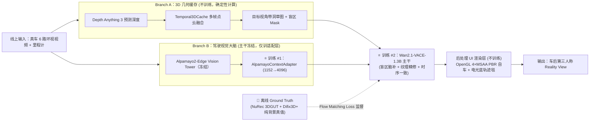

# Research & Engineering Notes: Reality View 全链路、GT 方案与 2024–2026 学术调研

本文档系统记录 `open-tesla-reality-view` 在架构设计、离线 Ground Truth（GT）数据工厂评估、2024–2026 学术界前沿流派调研以及关键渲染工程排障中的核心结论，作为后续 Stage 0 改造、v1 训练与 v2 实时化演进的参考依据。

---

## 1. 全链路总览：离线“造题工厂” vs 线上“实时推理模型”

理解本项目的核心前提是区分两个完全独立的阶段：

1. **Stage 0 离线标准答案工厂（`NuRec 26.10 + Difix3D+`）**
   - 现实中的量产车车尾没有无人机，无法直接同步采集“6 路车身摄像头”与“车后 13 米高空俯视画面”的配对数据。
   - 因此借助 NVIDIA 离线重建好的 3D 高斯驾驶沙盘（`PhysicalAI-Autonomous-Vehicles-NuRec`，1,601 个 20 秒真实街景），在同一时间戳下既渲染 6 路车载输入，又渲染车后第三人称高清真值（经 `Difix3D+` 去伪影），批量生产 `(6路输入 -> 第三人称真值)` 训练对。
   - **定位**：离线 ETL 数据工厂，**不会也不可能部署到陌生道路的车端**。

2. **线上推理模型（`Branch A + Branch B + Wan2.1-VACE + Post-VAE UI`）**
   - 上线后彻底脱离 NuRec 沙盘：只要输入任意陌生道路的 6 路环视视频 + 车辆里程计，即可端到端生成车后第三人称 Reality View。



### 真正需要训练的模块
| 模块 | 代码路径 | 是否训练 | 作用 |
| :--- | :--- | :---: | :--- |
| `Temporal3DCacheProjector` + DA3 | `src/open_reality_view/geometry/projector.py` | 否（确定性/冻结） | 构造几何脚手架，将 ~90% 已知像素锚定在准确 3D 坐标，防幻觉 |
| `AlpamayoVisionEncoder` | `src/open_reality_view/models/alpamayo_encoder.py` | 否（冻结） | 复用开源智驾大模型视觉表征（光照、语义、动态物体） |
| **`AlpamayoContextAdapter`** | `src/open_reality_view/models/alpamayo_encoder.py` | **是（Stage 1A/1B）** | 融合 Plücker Ray 视角编码并做 `1152 -> 4096` 协议转换 |
| **`WanVACETransformer3DModel`** | `src/open_reality_view/models/vace_reality_view.py` | **是（Stage 1B）** | 核心视频生成/修复主干，学习补全盲区、去伪影与多帧连贯 |
| `EgoVehicleCompositor` + `trajectory_overlay` | `src/open_reality_view/geometry/ego_car.py` | 否（OpenGL 渲染） | 在生成背景最上层叠加 4× MSAA PBR 车模与深度遮挡轨迹带 |

---

## 2. 对照特斯拉 FSD v15 Reality View

### 2.1 官方披露核验（马斯克 X 原帖，2026-11-22 前后）

FSD v15.0.1 于 **2026-11-21 前后**开始向首批用户推送 Reality View，马斯克表示 12 月扩大推送，仅最新硬件可用。以下技术细节**均来自马斯克本人 X 原帖**（Tesla 未发布正式技术报告或验证数据，应视为公司自述）：

| 细节 | 马斯克原帖要点 | 可信度 |
| :--- | :--- | :---: |
| **云端世界模型** | *"We've had a ~pixel-perfect world model since last year, which is critical for synthetic data generation."* —— 2025 年起即有近像素级世界模型，**核心用途是合成训练数据** | ✅ 原帖 |
| **车端渲染器** | 云端世界模型的 *"(much) smaller version"*：**conditional mean-flow** 模型（帖中亦称 ~1B diffusion 模型），从 **Tesla Universal Vision Encoder (UVE)** 分叉，以**最近一段 UVE 特征序列**为条件 | ✅ 原帖 |
| **生成方式** | **将上一帧加噪、再去噪为当前帧**（自回归热启动，而非每帧从纯噪声生成） | ✅ 原帖 |
| **输出与算力** | 每次生成 **8 帧 @ 36 fps**、UI 屏幕分辨率；占用 **半个 AI4 TRIP 引擎**；随 UVE 以 **18 Hz** 运行，工作量**摊在 4 个周期**内完成（8 帧 ≈ 222 ms 视频 ≈ 4 个 UVE 帧） | ✅ 原帖 |
| **延迟** | 承认 *"a bit high due to compute constraints"*；计划把**更新鲜的 encoder 特征穿插注入 DiT 层**，预计降低约 **35%** 延迟（截至 11 月尚未部署） | ✅ 原帖 |
| **交互** | 可在 Reality View 画面上点任意位置让车开过去；转向 chevrons 渲染在空中 | ✅ 原帖 |

来源：
- [Elon Musk — pixel-perfect world model / conditional mean-flow（2026-11-22）](https://x.com/elonmusk/status/2124458557525397780)
- [Elon Musk — "re-renders reality with chevrons in the sky"](https://x.com/elonmusk/status/2124238164512714925)
- 二手解读：[The Tesla Newswire](https://x.com/TeslaNewswire/status/2124502660670009468)、[@tslaming](https://x.com/tslaming/status/2124474912161087636)、[Wccftech](https://wccftech.com/tesla-is-running-a-1-billion-parameter-ai-model-inside-its-cars-to-generate-real-time-visuals-at-36-fps/amp/)、[Dataconomy](https://dataconomy.com/2026/11/25/tesla-begins-fsd-v15-rollout-with-ai-generated-reality-view/)、[Particle（用户反馈：画质好评、延迟明显）](https://particle.news/story/teslas-fsd-v15-reality-view-draws-praise-for-visuals-and-criticism-for-noticeable-lag)

> **核验提示**：Reality View 的一手信息主要在 X 上，通用新闻搜索容易漏检；核验特斯拉相关说法时应直接检索 x.com。

### 2.2 推理架构对照

| 维度 | 特斯拉 FSD v15 Reality View | `open-tesla-reality-view` 路线 | 对齐度与取舍 |
| :--- | :--- | :--- | :--- |
| **核心范式** | 从共享 FSD 感知主干（UVE）分叉，将“智驾眼中的世界”解码为写实第三人称画面 | 冻结开源智驾视觉主干 `Alpamayo2-Edge` + 神经视频生成解码器 | **核心思想对齐**（✅ 原帖证实） |
| **条件输入** | 仅 UVE 特征序列 + 上一帧（原帖未提及显式几何分支） | UVE 替代品（逐图独立编码的 2D tokens）+ **Branch A 显式几何** | 我们的视觉塔冻结且无多视角 3D 融合，必须外挂几何补位 |
| **3D 几何防幻觉** | 依赖 UVE 内部端到端学出的隐式 4D 空间表征 | 外挂 **Branch A（DA3 + 多帧 3D Cache）** 显式投影脚手架 + 15% Dropout | **中小算力务实折中**：500 A100h 级即可稳收敛且零车体漂移 |
| **时序机制** | **上一帧加噪 → 去噪为当前帧**，8 帧分块自回归 | v1 整段双向生成；v2 才做因果分块 + KV cache | **v2 需补齐上一帧热启动**（见 2.4） |
| **少步推理** | Conditional Mean-Flow（+ 上一帧热启动天然减少所需步数） | v1 15–30 步；v2 `Causal-rCM` / Self-Forcing 蒸馏到 1–2 步 | 方向一致，两者可叠加 |
| **自车与规划蓝毯** | 车端高精度 3D 自车模型 + 实时环境光反射 + FSD Planner 路径 chevrons | 4× MSAA 213k 面 PBR `.glb` 车模 + NuRec 天空盒 IBL + 深度遮挡蓝毯（后置叠加） | **对齐** |
| **推理与实时性** | 半个 AI4 TRIP、18 Hz UVE、8 帧 @ 36 fps，延迟仍偏高 | **v1** 先跑通多步高质量生成；**v2** 做 `Causal-Forcing` 1–2 步蒸馏 + `LongLive` KV-Cache + `Stream-VAE` + FP8 | **先质量、后实时化**；特斯拉的延迟问题提示 v2 需从一开始就按端到端延迟设计 |

### 2.3 训练路线对照

```text
特斯拉（据原帖）：
  车队真实视频 ──(自监督)──▶ 云端 ~pixel-perfect 世界模型（大）
                                   │ 合成训练数据（含任意视角）
                                   ▼
  UVE 特征序列 + 上一帧 ──▶ 车端 ~1B Conditional Mean-Flow（小，少步）

本项目（v1 → v2）：
  NuRec 3DGS 场景 + Difix3D+ ──(渲染)──▶ 配对伪真值
      ──(流匹配监督)──▶ Wan2.1-VACE v1（多步，双向）──(蒸馏)──▶ v2（1–2 步，因果）
```

| 维度 | 特斯拉 | 本项目 | 差距性质 |
| :--- | :--- | :--- | :--- |
| **造 GT 的“老师”** | 大型生成式世界模型（✅ 原帖：*critical for synthetic data generation*） | 离线 3DGS 重建 + 逐帧单步扩散修图 | **最根本差异**：我们的画质天花板被 3DGS 伪影 + `Difix3D+` 帧间闪烁锁死 |
| **老师的训练信号** | 车队真实视频（推断：预测未来帧/其他视角的自监督） | NVIDIA 离线逐场景优化（已由官方集群完成） | 他们的老师可持续随车队数据扩展；我们的固定为 1,601 个场景 |
| **视觉编码器** | UVE 与驾驶任务联合训练，Reality View 从其分叉 | 冻结 `Alpamayo2-Edge` 视觉塔，只训 Adapter | 冻结是算力约束下的必然选择 |
| **学生训练方式** | 原帖未披露（推断：在世界模型合成数据上训练 / 蒸馏） | Stage 1A Adapter 预热 → 1B LoRA r=64 / 全量微调，流匹配速度损失 | — |
| **少步化** | Mean-Flow 本身 + 上一帧热启动 | v2 `Causal-Forcing` + `Causal-rCM` 蒸馏 | 对齐 |
| **数据规模 / 算力** | 车队级数据 + 超大训练集群 | 1,601 场景 × 20 s；~500–600 A100h | 数量级差距，靠复用开源权重弥补 |

### 2.4 对本项目路线的直接启发

1. **v2 加入“上一帧热启动”（Previous-Frame Warm-Start）**：生成当前 chunk 时，不从纯噪声出发，而是把上一 chunk 的输出 latent 按 ego 位姿变换（复用 `Temporal3DCacheProjector` 的位姿链路）后加噪到中间噪声水平，再去噪。好处：所需步数更少；时序连贯性由结构保证，而不必全靠 KV cache 学；与特斯拉做法一致。**训练时“上一帧”必须使用模型自身的生成结果（Self-Forcing 思路）**，否则推理时误差会逐帧累积。
2. **引入“大世界模型当老师”（v1.5）**：特斯拉的 GT 来源是生成式世界模型而非 3DGS。开源对应物为 `nvidia/omni-dreams-models`（2B 因果蒸馏 720p@30fps）与 `nvidia/Cosmos3-Nano-Sim-Transfer`（见第 7.3 节）：用于对 NuRec 渲染结果做**视频级**精修（替代逐帧 `Difix3D+`、缓解闪烁），以及把 CARLA 追尾画面写实化。建议由“可选”升级为 v1 之后的主线方向。
3. **延迟预算前置**：特斯拉在半个 TRIP 上仍延迟偏高，并靠“深层注入新鲜 UVE 特征”补救。v2 的 chunk 长度、步数与特征注入点应从设计之初按端到端延迟（采集 → 显示）来定，而非只看吞吐 FPS。

---

## 3. Ground Truth 生成方式评估与待修工程清单

### 3.1 行业 4 种第三人称 GT 路线对比（2026）
| 路线 | 代表方式 | 优势 | 局限性 |
| :--- | :--- | :--- | :--- |
| **1. 纯游戏引擎仿真** | CARLA / UE5 | 零伪影、几何与深度 100% 精确、视角无限自由 | Sim-to-Real 域差大，真实视频泛化易出现“塑料游戏感” |
| **2. 车队多车重跑 / 实拍** | Tesla / Waymo 内部车队 | 真实光学、零重建伪影 | 开源界无法获取 |
| **3. 预重建 3DGS + 单步扩散精修**（**当前采用**） | `NuRec 26.10` + `Difix3D+` | **开源性价比最高**：真实驾驶光学 + 省去数千卡时单场景建图 | ① 极远处天空/电线偶发 3DGS 团状残影；② 逐帧 `Difix3D+` 有轻微帧间高频抖动；③ 源 6 路输入为二次渲染而非原生 RAW |
| **4. 3DGS + 视频扩散迭代反哺** | `ReconDreamer++` / `DriveDreamer4D` / `StreetCrafter` | 大偏角与帧间一致性达到离线天花板 | 算力贵 **10–30×**（单场景反复跑视频扩散 + 重训 3DGS），难铺千级场景 |

**结论**：主干采用 `NuRec 26.10 + Difix3D+` 仍是开源第一梯队选择，无需推倒重来。

### 3.2 开训前必须修复的 Stage 0 工程缺陷（代码审计结论）
对 `scripts/batch_export_nurec.py` 与 `scripts/precache_features.py` 审计发现以下 **4 项高优先级改进**，须在大规模导出前落地。

**落地状态（2026-11-25 复查代码）**：

| # | 项目 | 状态 | 代码位置 |
| :---: | :--- | :---: | :--- |
| 1 | GT 纯背景导出 | ✅ 已修复 | `batch_export_nurec.py` 已改为 `composite_ego=False` 后再 `refiner.refine()` |
| 2 | 深度 Train-Test Skew | ❌ 未修复 | `batch_export_nurec.py` 仍以 `save_depths=True` 导出 NuRec 完美深度；`precache_features.py` 直接读取 `clip.surround_depth` |
| 3 | `Difix3D+` 时序闪烁 | ❌ 未修复 | `--min-psnr` 默认仍为 `28.0`（建议 `30.0`）；尚无多参考帧 / 跨帧一致性校验 |
| 4 | 黄金构图与原生分辨率参考图 | ❌ 未修复 | 参考图仍硬编码 `576×1024`；`configs/v1_edge_wan21.yaml` 默认追尾相机仍为旧的 `(-7.5, 0, 4.2) / -18°` |

**优先级**：第 2 项影响最大（直接决定上线泛化），应最先修复。

1. **GT 必须导出纯背景（严禁先贴自车再过 `Difix3D+`）** —— ✅ 已修复
   - 原问题：`batch_export_nurec.py` 调用 `render_frame_bundle(..., composite_ego=True)` 后再调用 `refiner.refine()`，会把自车送进 VAE 糊化，且迫使生成模型浪费容量去学画自车。
   - 改造：改为渲染纯背景 → 原生分辨率 `Difix3D+` 精修 → 直接保存为 `chase_gt`；自车与蓝毯仅在推理/可视化后处理叠加。
2. **根治深度图的 Train-Test Skew（训练/推理分布漂移）** —— ❌ 待修
   - 现状：`batch_export_nurec.py` 导出的是 NuRec 完美 3DGS 深度；但线上推理到陌生马路时，只能拿到 `Depth Anything 3` 的带噪估计深度。
   - 改造：在 `precache_features.py` 中优先使用 `DA3-BASE` 估计深度（或按比例混合 DA3 深度 + 随机尺度/边缘抖动）生成 Branch A 投影草图，保证训练分布与真实线上一致。
3. **缓解逐帧 `Difix3D+` 的时序闪烁（Temporal Flicker）** —— ❌ 待修
   - 改造：筛选高 PSNR 场景（`>= 30 dB`）；探索为 `Difix3D+` 提供多参考视角（当前帧前视 + 上一帧已精修帧）或在导出阶段做跨帧一致性校验，过滤残缺严重片段。
4. **同步黄金构图与原生分辨率参考图** —— ❌ 待修
   - 现状：`batch_export_nurec.py` 仍停留在旧低头视角（`offset=(-7.5,0,4.2), pitch=-18°`）与硬编码 `576×1024` 参考图。
   - 改造：同步至已验证的 Tesla 追尾构图（`radius=13.8m, elevation=11.5°, fov_x=74°, look_at=(ego_x+4.5, 0, 1.25)`）并加入随机视角扰动（`azimuth ∈ [-30°, +30°]`、`elevation ∈ [10°, 22°]`），且参考图分辨率与目标分辨率精确对齐，消除二次缩放模糊。

---

## 4. 2024–2026 学术界四大技术流派调研

| 流派 | 代表工作（2024–2026） | 核心机制 | 优势 | 瓶颈 |
| :--- | :--- | :--- | :--- | :--- |
| **流派一：前馈 3D/4D 高斯预测**<br>*(Feed-Forward 3DGS)* | **Instant NuRec** (NVIDIA, 2026)<br>**STORM** (NVIDIA, 2025)<br>**DrivingForward** (AAAI 2025)<br>**Omni-Scene** (CVPR 2025) | 用 ViT/DA3 风格主干单次前向（200ms–1.5s）直接从多视角视频预测分层动态 3DGS | **极快、360° 强一致**；可用普通 6 路视频**自监督训练**，不依赖第三人称 GT | 回归式预测在大偏角（车后高空）盲区易发糊、拉丝、出浮空噪点，视觉质感不及扩散模型 |
| **流派二：3D 缓存 + 可控视频扩散**<br>*(3D-Guided Video Diffusion)*<br>**← 我们当前 v1 路线** | **GEN3C** (NVIDIA, CVPR 2025)<br>**TrajectoryCrafter** (腾讯 ARC, ICCV 2025 Oral)<br>**StreetCrafter** (ZJU3DV, 2025)<br>**ReCamMaster** (ZJU+快手, 2025) | 解耦“确定性 3D 投影草图”与“视频扩散语义生成”，用 3D Cache 锁定结构、扩散模型补全盲区与材质 | **画质天花板最高**、盲区脑补逼真；基于开源视频 DiT 微调，**中小算力（500 A100h）即可落地** | 依赖高质量第三人称配对 GT；多步采样推理慢，需 v2 步数蒸馏 |
| **流派三：离线 3DGS + 视频扩散迭代反哺**<br>*(Iterative Generative Reconstruction)* | **ReconDreamer / ReconDreamer++** (2025)<br>**DriveDreamer4D** (2025)<br>**Difix3D+** (CVPR 2025)<br>**FreeSim** (2025) | 3DGS 渲染大偏角退化图 → 视频/图像扩散修复 → 伪真值倒灌回 3DGS 重优化 | 离线重建画质与帧间稳定性极佳，适合闭环仿真资产生产 | 单场景重优化算力开销大 10–30×，难低成本规模化 |
| **流派四：前馈 4DGS + 单步扩散精修**<br>*(Hybrid Real-Time Target)* | `STORM / Instant NuRec` + `Difix3D+ / 1-step VACE` | 前馈 4DGS（~100–200ms）快速建出完整 3D 高斯场景 → 2ms 任意视角光栅化 → 1 步轻量扩散精修（~30ms） | **兼顾流派一的实时/强 3D 一致性与流派二的照片级画质**；精修器学习难度大幅降低 | 需要强前馈 4DGS 预训练权重作为前端 |

### 演进式架构策略（v1 → v2）
我们的 Branch A 接口只约定输出 `(coarse_rgb, hole_mask, target_depth)`：
- **v1（当前务实落地）**：走 **流派二**（`DA3 + Temporal3DCache` + `Alpamayo2-Edge` + `Wan2.1-VACE`），低算力快速跑出高清效果。
- **v1.5（GT 升级，对齐特斯拉“世界模型造数据”）**：用 `omni-dreams` / `Cosmos3-Nano-Sim-Transfer` 对 NuRec 渲染与 CARLA 追尾做视频级精修 / 写实化，替代逐帧 `Difix3D+`（见第 2.4 节）。
- **v2（平滑切换至流派四）**：已于本地 RTX 3080 20GB 实测跑通 **`nvidia/instant-nurec`**（见第 5 节），可直接**热插拔替换 Branch A 的点云缓存**，并结合 `Causal-Forcing` 1–2 步蒸馏实现车端级实时流式渲染。

---

## 5. 开源世界模型与前馈 3DGS 实测验证（2026 年底 Hugging Face 核验）

| 模型（Hugging Face ID，均已实测 `gated=False`） | 参数量 / 权重体积 | 本地 RTX 3080 20GB 实测可行性 | 工程定位 |
| :--- | :---: | :--- | :--- |
| **`nvidia/instant-nurec`** (`pa-multiview`) 🔥 | `202M` / **`0.68 GB`** | **✅ 已实测跑通！**<br>• 5路×6帧 (30图)：**`867 ms` / 显存增量 `3.86 GB`**，覆盖率 **`95.5%`**<br>• 5路×12帧 (60图)：**`1.73 s` / 显存增量 `6.81 GB`**，覆盖率 **`96.1%`**<br>• 免费自带 5 类语义分割 + 观测天空盒 | **超级 Branch A 底座候选**（从 DA3 满屏黑洞跃升至 `96.1%` 完整 3DGS 半成品）；不可直接替代离线 GT |
| **`nvidia/GEN3C-Cosmos-7B`** | `7B` / `26.96 GB` | **❌ 3080 跑不动**（全卸载仍需 `~43 GB VRAM`，需 A100/H100 80GB） | 留到 Colab A100 80GB 阶段作为离线视频级精修 Teacher 对比 `Difix3D+` |
| **`depth-anything/DA3-GIANT-1.1`** / **`tencent/HY-World-2.0`** | ~1.2B | 可评估 | 通用静态 3D 重建强，动态车辆拆分不如 `Instant-NuRec` 专业 |
| **`KlingTeam/ReCamMaster-Wan2.1`** / **`TrajectoryCrafter`** | 1.3B–5B | 单目转视角 | 盲区易幻觉，不适合直接造自动驾驶 GT；`ReCamMaster-Wan2.1` 相机控制注入设计可参考 |

### `Instant-NuRec` 零离线地图 / 零训练实测核心结论（客观像素级复盘）
- **实测方法**：仅输入 5 路因果环视图像（`504×280`，全为当前与过去帧，零离线 3D 地图、零未来帧），经 `Instant-NuRec` (`pa-multiview`) 现场生成 3D 高斯 → `triton_3dgs.py` 渲染 720p → `Difix3D+` 单步精修 → 后置 4× MSAA PBR 自车与蓝毯。
- **客观差距（零训练 `Instant-NuRec + Difix3D+` ≈ 55–60 分 vs 离线 `NuRec 26.10 + Difix3D+` ≈ 85–90 分）**：
  1. **主车道大结构极稳**：自车周边主车道、双黄线、绿色自行车道、红木围墙下半段及紧邻前车 SUV 位置严丝合缝无漂移；
  2. **四大明显短板**：① 右下角路边停靠银车出现断裂变形（`504×280` 边缘畸变 + 过滤 `MOVABLE` 误伤静止车）；② 右上角大棕榈树几乎消失且天空边缘带冷灰锯齿；③ 左侧一排白色防撞小立柱全部糊没；④ 前车上方远景路口发雾；
  3. **三条铁律结论**：**❌ 绝不能用 `Instant-NuRec` 替代离线 `NuRec 26.10` 造 GT**；**❌ 绝不能幻想靠免训练拼装追上特斯拉**；**✅ 它真正赢麻的对象是旧的 DA3 稀疏点云（Branch A），必须后接经高质量 GT 微调过的 `Alpamayo + Wan2.1-VACE` 才能还原旁车/立柱/棕榈树/落日光影**。

---

## 6. 特斯拉 GT 来源分析与开源“混合多源 GT”配方

### 6.1 特斯拉 FSD v15 Reality View 的 GT 并非单一 3DGS
特斯拉未公开完整训练数据配方。综合马斯克与 Ashok Elluswamy 公开披露的信息，其 GT 很可能是以下来源的混合。**按证据强度标注**：

1. ✅ **云端“~pixel-perfect 世界模型”合成数据（原帖证实，主来源）**：马斯克原帖 *"We've had a ~pixel-perfect world model since last year, which is critical for synthetic data generation"*，车端 ~1B Conditional Mean-Flow 是其 *"(much) smaller version"*（见第 2.1 节）。
2. ⚠️ **自研动态 3DGS / 离线神经场景重建引擎（有公开演示，但未说明用于 Reality View）**：Ashok 公开演示过 ~220ms 级生成式 3DGS 与离线场景重渲染。
3. ❓ **海量互联网视频预训练（推测）**：若世界模型 / UVE 底座见过航拍与无人机跟拍视频，则天然具备车外第三人称先验。
4. ❓ **车队真实照片监督（推测）**：同路段前后车互拍（后车前视即前车真实第三人称跟拍）+ 单车“时间错位视角”（`t = 0s` 的真实前视画面位于 `t = 1.5s` 时车身正后方 10–15 米处）。

> **结论修正**：原帖表明特斯拉造第三人称 GT 的核心是**生成式世界模型**，而非 3DGS 重建或多车互拍；本项目“NuRec 3DGS + `Difix3D+`”是在没有开源像素级世界模型时的替代方案，v1.5 应向“世界模型当老师”靠拢（见第 2.4 节）。

### 6.2 开源界最优“混合多源 GT”策略与导出耗时说明
- **导出耗时澄清**：离线 70 分钟/场景的重建成本已由 **NVIDIA 官方集群提前买单**（1,601 个预重建 `.usdz` 直接存放在 Hugging Face）；我们本机 RTX 3080 仅需下载与渲染，**480×832 17 帧仅 ~30–45 秒/条**（720p ~6.7 秒/帧，A100 仅 ~10–15 秒/条），每个 20 秒场景可切出 3–5 条训练样本。
- **推荐混合配方（突破单一 3DGS 天花板）**：
  1. **~70% 主力 — 提纯版 `NuRec 26.10`（纯背景 GT）**：仅选 `PSNR >= 30 dB` 高分场景，纯背景精修、同步 Tesla 黄金构图与多角度采样；
  2. **~15% 真实光学锐度锚点 — 真实原片视角 + 时间错位前视真图**：从同标定母库 `nvidia/PhysicalAI-Autonomous-Vehicles`（1,700+ 小时真车原片）抽原生未二次渲染帧，强迫模型保持 100% 真实相机锐度与光影；
     - **局限**：时间错位前视真图的相机高度约 `1.4 m`，只能监督**低仰角**视角，覆盖不了 `radius=13.8 m / elevation=11.5°` 的高空追尾构图；且 1.5 s 内动态物体已移动，**只能监督静态背景**，须先用分割/跟踪结果 mask 掉动态物体再计算损失；
  3. **~15% 极端几何补充 — CARLA / UE5 仿真追尾（可叠加 `Cosmos-Transfer` 写实化）**：补足 3DGS 在高俯角（30°–50°）及远景细电线杆/路牌上的先天短板；
  4. **独立评测尺子**：留出未见路段，并可接入 2026 真实多车/无人机同步跟拍数据集（如 `MV2`）作为终极零重建伪影 Benchmark。

---

## 7. NVIDIA 2026 自动驾驶与 Physical AI 开源全家桶清单（HF 实测核验）

以下资产均通过 Hugging Face API 实测确认存在并核验权限与用途：

### 7.1 自动驾驶 VLA 感知与决策大脑（Alpamayo 家族）
| 仓库 ID | 状态 | 核心能力与对本项目价值 |
| :--- | :---: | :--- |
| **`nvidia/Alpamayo2-Edge`** | ✅ 已集成 | 2.65B 车端轻量 VLA，0.41B SigLIP2 视觉塔（0.78GB）作为我们的共享 UVE，自带 64 点规划头 |
| `nvidia/Alpamayo-1.5-10B` / `Alpamayo2-Super` / `Alpamayo-R1-10B` | 参考 | 10B+ 带 Chain-of-Causation 因果思维链推理的智驾教师大模型 |

### 7.2 3D 驾驶场景重建、资产与渲染（NuRec 家族）
| 仓库 ID / GitHub | 状态 | 核心能力与对本项目价值 |
| :--- | :---: | :--- |
| **`nvidia/PhysicalAI-Autonomous-Vehicles-NuRec`** | ✅ 已集成 | 1,601 个离线精建 20s 7 相机+LiDAR 3DGS 场景（`.usdz`），Stage 0 GT 主力底座 |
| **`nvidia/PhysicalAI-Autonomous-Vehicles`** | 🔥 高价值 | **1,700+ 小时真车原始视频 + LiDAR 母库**，与 NuRec/Alpamayo 完全同标定，做真实光学监督零适配成本 |
| **`nvidia/instant-nurec`** (`github.com/NVIDIA/instant-nurec`) | ✅ 已实测 | 202M（0.68GB）前馈 3DGS，RTX 3080 上 867ms 现场生成 95.5% 覆盖率 3D 沙盘 |
| **`nvidia/difix_ref`** / `nvidia/difix` | ✅ 已集成 | 单步 3DGS 去伪影修图器（720p ~850ms，6.8GB 显存） |
| `NVlabs/alpasim` & `NVIDIA/3DGRUT` | 参考 | NVIDIA 官方 gRPC 微服务闭环驾驶仿真框架 + 3DGUT 底层渲染重建代码 |
| `nvidia/PhysicalAI-NuRec-PPISP` / `NuRec-AV-Object-Benchmark` | 参考 | 物理相机曝光/暗角/白平衡 ISP 校正模块 & 动态物体插入评测集 |

### 7.3 自动驾驶世界模型与实时少步渲染器（Cosmos 2.5 / Cosmos 3 / OmniDreams）
| 仓库 ID / GitHub | 权限 / 体量 | 核心能力与对本项目价值 |
| :--- | :---: | :--- |
| **`nvidia/omni-dreams-models`** (`nv-tlabs/omni-dreams`) 🔥🔥 | `gated=auto` / 34.5 GB<br>NVIDIA Open Model License（可商用） | **动作条件闭环驾驶世界模型**（基于 `Cosmos-Predict2.5-2B`，约 400 万段 20 s 多视角驾驶视频训练）。⚠️ **仅生成单路前视**；输入为首帧 RGB + 车道线/3D 框世界状态视频 + 文本，输出 `704×1280`；发布版 `2b_res720p_30fps_i2v_hdmap_distilled.pt` 为 30 fps 输出、**~52 FPS @ 1× GB300**（官方硬件：H100 / Blackwell，非消费卡实时）。**不能直接当我们的生成器用（且基于 Cosmos 而非 Wan，权重不通用）**；真正价值是**完整公开了三阶段蒸馏配方与对应 checkpoint**，见 7.5 节 |
| **`nvidia/Cosmos3-Nano-Sim-Transfer`** 🔥 | `gated=False` / ~31.7 GB<br>OpenMDW 1.1（可商用） | ⚠️ 名为 Nano，实际 **16B 参数**（BF16 transformer ~30 GB），面向 GB200 多环境批量实时推理设计。因果蒸馏少步版，按小 latent chunk 自回归生成；控制输入 `depth / segmentation / edge / blur` + 文本，输出 **480p @ 30 fps、最长 600 帧**。**RTX 3080 跑不动**，仅作 A100/H100 80GB 离线精修的质量上限对照 |
| **`nvidia/Cosmos3-Nano-Transfer-Auto`** | `gated=False` / 32.1 GB | 自动驾驶专用多视角控制生成，支持最多 **11 路同步鱼眼/标准相机 + LiDAR**，适合晴/雨/夜极端天气数据扩增（体量同上，仅限大卡离线） |
| **`nvidia/Cosmos-Transfer2.5-2B`** 🔥🔥 & `Cosmos-Predict2.5-2B` / `14B` | `gated=auto`<br>NVIDIA Open Model License（可商用） | **我们最现实的视频级精修器**：**2.36B 参数**（每个 control 分支 ckpt ~4.7 GB），控制输入 `edge / blur / seg / depth`（原生框架最多叠加 4 路；diffusers 0.43 `Cosmos2_5_TransferPipeline` 每次加载一个 controlnet），输出 **720p @ 16 fps**；文本编码器为 `Qwen2.5-VL`（`Cosmos-Reason1-7B`）。`auto/multiview` 权重的 **7 路相机布局（前中/前左/前右/后左/后右/后长焦/前长焦）与 `PhysicalAI-AV` 完全一致**，另有 `distilled` 少步版。用途：NuRec 追尾视角**整段**精修（替代逐帧 `Difix3D+`）、CARLA 写实化、7 路输入天气/昼夜扩增 |
| `nvidia/PhysicalAI-Autonomous-Vehicle-Cosmos-Drive-Dreams` | `gated=False` | 公开合成多视角驾驶视频数据集 |

### 7.4 通用 3D 世界生成与相机控制
| 仓库 ID | 权限 / 体量 | 核心能力与对本项目价值 |
| :--- | :---: | :--- |
| **`nvidia/GEN3C-Cosmos-7B`** | `gated=False` / 27.0 GB | 7B 级 3D Cache 相机可控视频模型（43GB 显存）。功能与 `Cosmos-Transfer2.5-2B` 精修用途重叠且体量大得多，**降级为不优先** |
| `nvidia/Lyra-2.0` (`arXiv:2604.13036`) | `gated=False` / 91.6 GB | 单图长程可探索 3D 世界生成，其用逐帧 3D 几何做历史帧路由以消除“空间遗忘”的思想值得长期关注 |

### 7.5 可直接为本项目所用的三条落地路径（2026-11-25 按官方 model card 复核）

**① `omni-dreams` = 我们 v1 → v2 路线的官方验证版（抄配方，不抄权重）**

| omni-dreams 阶段（官方 checkpoint） | 做法 | 对应本项目 |
| :--- | :--- | :--- |
| L1b teacher（`single_view/teacher/3b4c21d0-…`） | 双向、多步、189 帧、HD-map 条件 | **v1**：Wan2.1-VACE 双向多步 |
| L2a student-init（`single_view/student-init/a12bf26e-…`） | 因果、多步，**Diffusion Forcing** | v2 Stage 2 第一步（`Causal-Forcing` 因果初始化） |
| L0 distilled（`single_view/distilled/e5cadda3-…`） | 因果、少步，**Self-Forcing + DMD**，渐进长上下文 teacher | v2 Stage 2 第二步（`Causal-rCM` 少步蒸馏） |
| 发布版 chunk-2（`2b_res720p_30fps_i2v_hdmap_distilled.pt`） | **每步 2 latent 帧 = 8 RGB 帧**，`flashdreams` 运行时 | 与特斯拉 Reality View 的 **8 帧/块**完全一致 |

参考代码：`nv-tlabs/omni-dreams` 的 `samples/post-training`（蒸馏流程）与 `NVIDIA/flashdreams`（chunk 流式推理运行时）。

**② `Cosmos-Transfer2.5-2B` 替代逐帧 `Difix3D+` 做视频级 GT 精修**
- NuRec 追尾渲染 → `blur`（+ `depth`）控制 → 整段生成，目标是消除逐帧 `Difix3D+` 的时序闪烁与远景 3DGS 残影。
- 实验脚本与结果见 `scripts/exp_cosmos_transfer_refine.py` 与第 9 节。

**③ “Instant-NuRec → Cosmos Transfer” 伪 GT 扩量链路（对标特斯拉“世界模型造数据”）**

```text
任意 PhysicalAI-AV 原片片段（30.6 万段，无需 NuRec 离线重建）
  → Instant-NuRec 现场前馈 3DGS → 渲染追尾视角（blur RGB + depth + 5 类语义分割）
  → Cosmos-Transfer2.5 精修 → 伪 GT
```
- **先校准**：在 1,601 个 NuRec 场景上跑该链路，与 `NuRec + Difix3D+` GT 对比，量化差距；
- **再扩量**：差距可接受则推广到无 NuRec 的原片，把训练数据从 1,601 段扩到上万段，覆盖更多地域/光照/天气；
- **风险控制**：Cosmos 可能幻觉；用 control-following 指标（Depth SI-RMSE、Seg mIoU、Blur SSIM）自动过滤；
- **附带收益**：该链路本身即“零训练基线”，我们训练的 v1 必须显著超过它。

**许可证要点**：Cosmos-Transfer2.5 / omni-dreams（NVIDIA Open Model License）与 Cosmos3（OpenMDW 1.1）**模型均可商用**；真正受限的是 `PhysicalAI-*` **数据集**许可（据第三方总结限于使用 NVIDIA 技术的内部 AV 开发）——由这些数据导出的训练对与微调权重能否公开分发，须逐条核对数据集许可。

**NuRec ↔ 原片映射（已验证）**：本地 NuRec 26.10 场景 UUID（`3582a449-…`、`bb5389f1-…`）均作为 `clip_id` 出现在 `nvidia/PhysicalAI-Autonomous-Vehicles` 的 `clip_index.parquet`（30.6 万段）中，对应 7 路原片位于 `camera/<cam>/<cam>.chunk_<NNNN>.zip`。尚待验证：NuRec 20 s 片段与原片时间戳是否严格对齐。

### 7.6 非 NVIDIA 高相关开源：蚂蚁灵波（Robbyant）LingBot 系列（2026-11-25 按 HF model card 核验）

| 仓库 ID | 发布 / 许可 / 体量 | 核心能力 | 对本项目价值 |
| :--- | :--- | :--- | :--- |
| **`robbyant/lingbot-map`** 🔥（论文 *Geometric Context Transformer for Streaming 3D Reconstruction*，[arXiv 2604.14141](https://arxiv.org/abs/2604.14141)） | 2026-04-16 / **Apache-2.0（可商用）** / 仓库 14.2 GB（含 balanced 与 stage-1 checkpoint） | **普通单目 RGB 视频（无需标定、无 LiDAR）→ 流式实时估计每帧相机位姿 + 稠密三维点云/深度**；前馈架构 + 分页 KV cache，`518×378` 约 **20 FPS**，可处理 **>10,000 帧**长视频；官方提供 **KITTI**（驾驶）与 Oxford Spires 评测脚本及室外长视频 demo | **① 互联网行车记录仪视频 → 训练数据（最大价值）**：恢复位姿 + 3D 结构 → 渲染追尾视角草图 → `Cosmos-Transfer2.5` 精修为伪 GT，突破 1,601 场景的地域/光照/天气分布瓶颈，对标特斯拉“海量视频预训练”；**② Branch A 长时序记忆**：现有 `Temporal3DCache` 仅约 6 帧窗口，可借鉴其上千帧一致性补全车底/车尾盲区 |
| **`robbyant/lingbot-world-v2-*`**（*Infinite Worlds with Versatile Interactions*） | 2026-09 / ⚠️ **CC BY-NC-SA 4.0（禁止商用）** / 1.3B causal-fast 6.84 GB | **基于 Wan2.2** 的因果、少步蒸馏交互式世界模型：14B `causal-fast` **每 chunk 4 步、无 CFG**，chunk 级 KV cache 流式生成，官方称 720p @ 60 fps（其自有平台）；HF 已有 `lingbot-world-v2-1.3b-causal-fast`、`14b-causal-fast`、`14b-causal-pretrain`、`14b-bid` | **v2 实时化参考**：与我们同属 Wan 系、且有 **1.3B** 规模的因果少步模型，与 `omni-dreams` 三阶段配方（双向 teacher → 因果 pretrain → causal-fast 蒸馏）互为印证；**仅限研究用途**，其 1.3B 权重结构能否与 `Wan2.1-VACE-1.3B` 对齐、可否作为 v2 初始化尚未验证 |
| `robbyant/lingbot-depth` 系列 | 2026 / — | 掩码深度建模的深度估计 / 深度补全 | 可作为 Branch A 深度（DA3）的备选对照，优先级低 |

**LingBot-Map 用于造数据的局限（须在实验中验证）**：
1. 输出为**点云**而非可渲染 3DGS，拉到 `13.8 m / 11.5°` 高空追尾视角会有大面积空洞，必须依赖后级生成模型补全；
2. 按 SLAM 思路假设场景近似静止，**行驶车辆大概率被拉成残影**，需先用分割/跟踪剔除动态物体；
3. 官方说明：未做状态重置时，最大推理范围受训练数据中见过的最远距离限制，超出后效果下降（长视频需用其 windowed 模式）；
4. 单路前视行车视频对车后上方区域**从未观测**，伪 GT 质量上限显著低于 NuRec 7 路离线重建——更适合作为**多样性补充**（建议占比 ≤ 15%），而非替代 NuRec 主力 GT。

来源：[robbyant/lingbot-map](https://huggingface.co/robbyant/lingbot-map)、[arXiv 2604.14141](https://arxiv.org/abs/2604.14141)、[IT之家报道](https://www.ithome.com/0/939/901.htm)、[robbyant/lingbot-world-v2-1.3b-causal-fast](https://huggingface.co/robbyant/lingbot-world-v2-1.3b-causal-fast)。

---

## 8. 关键渲染与工程排障记录（已解决）

1. **NuRec 时序傅里叶 Albedo 发灰洗白**（commit `a3adc4b`）
   - 根因：NuRec 26.10 `features_albedo` 形状为 `[N, K, 3]`，索引 `0` 为常值 DC 基色，`1..K-1` 为零均值时序谐波（对静态/部分动态体为 0）；此前取 `mean(dim=1)` 导致颜色被衰减 5×–20×。
   - 修复：提取 `albedo[:, 0, :]`（`nurec_renderer.py::_extract_base_albedo`）。
2. **画质糊化与自车被 VAE 模糊**（commit `282307f`）
   - 根因：早期流程先贴自车、再 `480p -> 576p -> 480p` 双线性缩放过 `Difix3D+` 且参考图仅 `224×384`。
   - 修复：`Difix3DRefiner.refine()` 默认 `process_hw=None` 原生分辨率（`720×1280`）精修纯背景，喂同分辨率前视参考图；**在 VAE 解码之后**再叠加 4× MSAA OpenGL PBR `.glb` 自车与电光蓝轨迹毯。
3. **3DGS 路面矩形“画面撕裂”与地下薄片穿帮**（commit `33cda92`）
   - 根因（双重叠加）：
     1. `triton_3dgs.py` 原设 `max_radius_px = 96` 硬截断，将屏幕半径 `150–480+ px` 的大扁平高斯强行切在 `16×16` tile 矩形边界上；
     2. NuRec 26.10 由 NVIDIA `3dgut-gsplat`（径向距离 + 3D 射线交点）训练，路面下 `1.4m` 藏有 `4.5m × 2.0m × 5mm` 扁平背景高斯；原光栅化器按高斯中心 `z` 排序，在 `z_路面 == z_中心` 处令地下薄片突然穿透路面。
   - 修复：移除 `96px` 硬截断改为透明度精确紧致椭圆分桶 `extend = sqrt(2 * ln(255 * opacity))`；采用**混合径向距离 + 大高斯逐 Tile 3D 射线交点深度 `t_hit` 排序（3DGUT / StopThePop 思想）**。
   - 收益：彻底消除所有矩形/水平撕裂，同时连带提升环视深度纯净度，将多帧 3D Cache 盲区率由 `9.2%` 进一步降至 `5.7%–6.6%`。

---

## 9. 实验：`Cosmos-Transfer2.5-2B` 视频级精修 vs 逐帧 `Difix3D+`（2026-11-25）

**目的**：验证 7.5 节路径 ②——用 Cosmos-Transfer2.5 对 NuRec 追尾渲染做整段视频级精修，能否在消除 3DGS 伪影的同时，比逐帧 `Difix3D+` 更少闪烁。

**脚本**：`scripts/exp_cosmos_transfer_refine.py`（`render` → `cosmos` → `eval` 三阶段），输出位于 `outputs/exp_cosmos_transfer/<scene>/`（`comparison_grid.jpg`、`comparison.mp4`、`metrics.json`、`meta.json`）。

**设置**：
- 场景 `bb5389f1`（加州郊区主干道，日落）；Tesla 追尾构图 `radius=13.8 m / elevation=11.5° / fov_x=74°`；`704×1280`、16 fps；**纯背景**（不贴自车）。
- Cosmos：diffusers `0.43.0` 的 `Cosmos2_5_TransferPipeline`（`revision=diffusers/general` + `diffusers/controlnet/general/blur`），`36` 步 UniPC、`guidance=3.0`，blur 控制为降采样 + 双边滤波的近似实现（官方预处理器未随 diffusers 发布）；7B Qwen2.5-VL 文本编码器在 CPU 上一次性编码（约 70 s），其余组件 `enable_model_cpu_offload` + VAE 分块解码。
- 环境：RTX 3080 20GB、torch `2.15.0`、transformers `5.24.0`；安全检查需 `cosmos_guardrail` + gated `nvidia/Cosmos-1.0-Guardrail`（许可证强制）。

**无参考指标**（没有真实的追尾真值）：`flicker` = 亮度时间二阶差分均值（↓ 越稳）；`fidelity` = 低通后与原始渲染的 PSNR（↑ 越忠实于布局/颜色，衡量幻觉）；`sharpness` = 拉普拉斯方差（↑ 越多高频，**伪影也会抬高它，必须结合画面看**）。

### 9.1 29 帧结果（8 个 latent 帧）

| 方法 | flicker ↓ | fidelity dB ↑ | sharpness | 耗时（29 帧） | 画面结论 |
| :--- | :---: | :---: | :---: | :---: | :--- |
| 原始 NuRec 渲染 | 4.74 | — | 58 | 30 s | 路面拉丝、左侧路缘糊、远景雾团 |
| **`Difix3D+` 逐帧** | 5.40 | 33.6 | 73 | 67 s | **最好**：拉丝与墙面明显修复，远景雾团仍在 |
| Cosmos（负面提示为空、控制权重 1.0） | 6.87 | 36.4 | 732 | 663 s（峰值 11.1 GB） | ❌ 树/栅栏/路面满屏笔刷状条纹伪影 |
| Cosmos（官方负面提示、控制权重 0.5） | 6.42 | 25.9 | 2031 | 670 s | ❌ 更严重的斑马纹，结构开始漂移 |
| Cosmos 诊断：17 帧、关闭 CFG、权重 0.5 | — | — | — | 201 s（峰值 9.7 GB） | ❌ 仍是斑马纹 |

**已排除的原因**：
1. **VAE 分块解码**：同一组 latent 分块 vs 不分块解码，平均像素差仅 `0.0017`，不分块同样有条纹；
2. **负面提示 / CFG**：关闭 CFG（`guidance=1.0`）后条纹依旧；
3. 控制权重：1.0 → 0.5 后更差（模型越依赖自身生成越崩），说明问题在**生成链路本身**而非超参数。

**踩坑记录**：
- 预先计算的 `prompt_embeds` 不会被管线自动搬到 GPU，需手动 `.to("cuda")`；
- `encode_prompt()` 不传 `negative_prompt` 时默认空串，**不等于**管线 `__call__` 的 `DEFAULT_NEGATIVE_PROMPT`；
- 704×1280 整段 VAE 解码在 20 GB 卡上 OOM（去噪已完成后才崩），须 `vae.enable_tiling()`，并在最后一步回调里先把 latent 存盘。

### 9.2 93 帧验证：条纹根因确认为“片段过短”

NVIDIA model card 写明 Transfer2.5 **以 93 帧（24 个 latent 帧）为单位效果最好**。在同一场景重新渲染 93 帧（5.8 s），以官方默认设置（官方负面提示、blur 控制权重 0.5、`guidance=3.0`、36 步）运行：

| 方法（93 帧） | flicker ↓ 原分辨率 | flicker ↓ σ=2 低通 | flicker ↓ σ=6 低通 | fidelity dB ↑ | sharpness | 耗时（RTX 3080） |
| :--- | :---: | :---: | :---: | :---: | :---: | :---: |
| 原始 NuRec 渲染 | 4.01 | 2.80 | 1.51 | — | 57 | 73 s（0.8 s/帧） |
| `Difix3D+` 逐帧 | 4.66 | 3.22 | 1.75 | **33.4** | 74 | 175 s（1.9 s/帧） |
| **Cosmos-Transfer2.5（blur, w=0.5）** | 7.35 | 3.25 | **1.52** | 31.6 | 957 | 3,326 s（**36 s/帧**，峰值 18.2 GB） |

**结论**：
1. ✅ **条纹/斑马纹完全消失**——根因就是 29/17 帧片段过短（8/5 个 latent 帧）超出训练分布，而非超参数或实现错误。**使用 Transfer2.5 必须按 93 帧整块生成**。
2. ✅ **画质明显超过 Difix**：路面沥青纹理、自行车道绿色标线与图标、路缘、消防栓等细节清晰写实，远景 3DGS 雾团被重绘为合理建筑/树木；视觉上最接近“照片级”。
3. ✅ **低频时序稳定性优于 Difix**：σ=6 低通闪烁 `1.52` ≈ 原始渲染 `1.51`，明显低于 Difix 的 `1.75`；原分辨率闪烁偏高主要来自新增的高频纹理随运动变化（是否表现为可感知的“纹理沸腾”需看 `comparison.mp4` 确认）。
4. ⚠️ **有轻度幻觉**：保真度 31.6 dB 低于 Difix 的 33.4 dB；远处车辆与局部 3DGS 伪影区域（如棕榈树根部的蓝色残影）被“重新解释”而非忠实修复。用作训练 GT 时需配合几何一致性过滤。
5. ❌ **成本过高，无法在 3080 上铺量**：36 s/帧，约为 Difix 的 19 倍；1,601 个场景 × 每场景若干 93 帧片段在 3080 上需上千小时。可行路径：A100/H100 离线批处理，或改用 4 步 `distilled/general/edge` 版本（理论约 9× 加速，需另测画质）。

**定位**：Cosmos-Transfer2.5 适合做**高质量 GT 的离线精修**（v1.5，大卡批处理、配合幻觉过滤），不适合本地快速迭代；本地/MVP 阶段仍以 Difix3D+ 为主力。产物：`outputs/exp_cosmos_transfer/bb5389f1_f93/`（`comparison_grid.jpg`、`comparison.mp4` 自上而下为 raw / Difix / Cosmos）。

---

## 10. NVIDIA 开源全量扫描（2026-11-25）：按链路环节逐项对照

**扫描方法**（可复现）：Hugging Face API 列出 `nvidia` 账号下全部 **1,069 个模型 / 362 个数据集**，按视觉/3D/驾驶关键词筛出 231 个模型、94 个数据集；GitHub 列出 `nv-tlabs`(59)、`NVlabs`(256)、`nvidia-cosmos`(12)、`NVIDIA`(626) 四个组织 2025 年以来有更新的仓库，筛出 238 个相关仓库；对候选逐个阅读 README / model card（许可证、体量、输入输出）。

> **核心结论：之前漏掉了两个几乎正中靶心的成果——`Harmonizer` 与 `ArtiFixer`。** 前者是“NuRec 渲染的单步、时间一致精修器”，后者是“基于 Wan2.1-1.3B、以 3DGS 渲染为条件的因果少步视频修复/补全模型”——分别对应我们“造 GT / 偷懒路线精修器”和“v1→v2 生成主干”两大核心模块。

### 10.1 第一梯队：直接改变路线的成果

| 成果 | 发布 / 许可 | 是什么 | 对我们的意义 |
| :--- | :--- | :--- | :--- |
| **`NVIDIA/harmonizer`** + HF `nvidia/Harmonizer`（CVPR 2026，[arXiv 2602.24096](https://arxiv.org/abs/2602.24096)） | 2026 / **NVIDIA Open Model License（可商用）** / 6.5 GB | 基于 `Cosmos-Predict2-0.6B` 的**单步、时间一致**在线生成式增强器：把多步扩散**蒸馏为单步时序模型**，修正 NuRec 渲染的新视角伪影、光照、阴影，并把插入的动态物体“协调”进场景；训练数据来自 3DGUT 重建（与 NuRec 同格式）；**训练集公开**（`nvidia/Harmonizer-Dataset`）；提供 temporal（论文版）与 non-temporal 两个 checkpoint | **① 替代逐帧 `Difix3D+` 造 GT**：单步 + 时序一致，正好同时解决“慢”（Cosmos-Transfer 36 s/帧）与“闪烁”（Difix）两难；**② 偷懒路线的在线精修器**：官方定位就是 online 模式，比“自己微调 Difix”更省事；**③ 可直接在我们的 NuRec 追尾渲染上做零训练对比**（下一步首选实验） |
| **`nv-tlabs/ArtiFixer`** + HF `nvidia/ArtiFixer` | 2026-06（14B）/ 2026-07（**1.3B**）/ 2026-09（双向 teacher）· ⚠️ **NVIDIA OneWay Noncommercial（仅研究）** · 全仓 276 GB | **少步、因果自回归视频扩散模型**，以 3DGS 渲染为条件**修复并外扩（补全缺失区域）**重建场景；提供 **Wan2.1-14B / Wan2.1-1.3B / Cosmos3-Nano** 三个变体，每个都有**蒸馏后的 S3 因果少步模型 + S1 双向 teacher**，并公开**三阶段训练配方**（双向训练 → … → 因果蒸馏） | **几乎就是我们 v1→v2 的成品版**：同为 Wan2.1-1.3B、同为“3DGS 渲染→视频扩散修复/补盲区”、同为“双向 teacher → 因果少步学生”。可：① 零训练直接在 NuRec / Instant-NuRec 追尾草图上测试；② 以 `artifixer-1.3b` 为初始化在我们的配对数据上微调（远少于从 Wan2.1-VACE 起训的 500 A100h）；③ 直接复用其蒸馏配方代替自研 v2。**局限**：训练于 DL3DV 通用场景（非驾驶、非高空追尾视角）；**非商用许可**——若项目将来要商用，只能借鉴方法、不能用权重 |
| **`nvidia/Fixer`**（`nv-tlabs/Fixer`，Difix V2） | 2025-11 / NVIDIA Open Model License / 4 GB | 基于 `Cosmos-Predict-0.6B` 的单步单帧 3DGS 去伪影，A100 50 ms / H100 26.5 ms，576×1024，训练于 NVIDIA 内部 AV 3DGUT 数据，可从预训练继续微调 | Difix 的直接升级；但单帧无时序，**整体被 Harmonizer 覆盖**，作为对照基线 |

### 10.2 第二梯队：补齐具体环节

| 环节 | 成果 | 许可 / 体量 | 用途 |
| :--- | :--- | :--- | :--- |
| GT 质检（幻觉过滤） | **`NVIDIA/cosmos-evaluator`** | Apache-2.0 | 官方提供 **Hallucination Check（运动掩码对比）、Objects Check（物体位置对应）**、属性核验、物理合理性打分，REST 微服务 + Python API——正是 9.2 节 Cosmos 精修 GT 所需的“幻觉过滤”，无需自研 |
| 动态车辆补全 | **`NVIDIA/asset-harvester`** | ~16 GB 显存 | 从部分/遮挡视角的驾驶日志中提取**完整 3D 高斯车辆/行人资产**并插回 NuRec——对症解决 Instant-NuRec 实测中“旁车断裂变形” |
| 行车记录仪视频 → 位姿 + 深度 | **`nv-tlabs/vipe`**（ViPE / ViPE-Long） | 开源 | 从无标定原始视频估计**内参、相机轨迹、近度量深度**，支持广角/全景、长序列（2026-11 新增 Depth Pro 2，~14–16 FPS）；与 LingBot-Map 同类，可作为“互联网行车视频造数据”（7.6 节）的 NVIDIA 方案 |
| 多视角几何（Branch A 深度备选） | `nv-tlabs/dvlt`（DéjàView，NeurIPS 2026 Oral） | 开源 | 循环 Transformer 多视角重建，输出逐像素射线/深度/置信度/位姿，官方与 **DA3**、VGGT、MapAnything 对比；可作为 DA3 的对照 |
| 前馈新视角合成 | `NVlabs/DVSM`（+ TTB，NeurIPS 2026 Spotlight） | 开源 | 单个 Transformer 以隐状态重建并渲染新视角，号称匹敌逐场景优化 3DGS；通用场景，驾驶高空视角适用性待测 |
| v2 少步蒸馏 | **`NVlabs/AnyFlow`** + HF `nvidia/AnyFlow(-FAR)-Wan2.1-1.3B-Diffusers` | 开源 / diffusers 格式 | 基于 flow map 的**任意步数**蒸馏，支持**因果与双向**、T2V/I2V/**V2V**，覆盖 1.3B–14B，已有 Wan2.1-1.3B 因果（FAR）权重——`Causal-rCM` 之外的现成备选 |
| v2 自回归蒸馏 | `nv-tlabs/cmd`（Context-Matched Distillation） | 开源 | 自回归视频蒸馏中 teacher 因果性匹配，chunk-4 推理管线（基于 Cosmos-Predict2.5-2B） |
| v2 流式推理运行时 | **`NVIDIA/flashdreams`** | Apache-2.0 | OmniDreams / Cosmos3-Nano-Sim-Auto 背后的自回归视频世界模型推理服务库，含驾驶交互 demo |
| 原片数据读取 | `NVlabs/physical_ai_av`（devkit）、`NVIDIA/ncore` | 开源 | 读取 `PhysicalAI-Autonomous-Vehicles` 原片 / NCore 格式——“原片输入 + NuRec 追尾 GT”配对管线直接用它 |
| 深度/分割真值（评测） | HF `nvidia/PhysicalAI-Autonomous-Vehicles-Foundation4D` | ⚠️ 非商用 / 9.2 TB / 1,253 段 | 激光雷达时序聚合的**逐相机深度真值**、2D 语义与实例掩码、体素占据与速度；可评测 Branch A 深度、为动态物体提供掩码（与 1,601 个 NuRec 场景 **0 重叠**，已核对 UUID） |

### 10.3 第三梯队：了解即可

| 成果 | 结论 |
| :--- | :--- |
| `nvidia/Cosmos3-Nano-Sim-Auto`（32 GB，OpenMDW） | Cosmos3-Nano-Transfer-Auto 的因果蒸馏版，**实时闭环**生成同步多路相机 + LiDAR（条件为车道线/3D 框 WSM 地图）；生成的是车载视角，非追尾视角；v2 架构参考 |
| `nvidia/Cosmos3-Edge`（9.2 GB，OpenMDW） | Cosmos3 端侧版全模态世界模型；`Alpamayo2-Edge` 视觉塔即 `cosmos3_edge_vision` 系 |
| HF `PhysicalAI-WorldModel-Synthetic-Autonomous-Driving-Scenarios`（4.4 TB，OpenMDW） | Omniverse 合成的 26.4 万段 4K 多相机环视视频（9 张地图、7 类场景）；**无追尾视角、无深度/位姿**，仅可作输入侧外观多样性补充 |
| HF `Cosmos3-Driving-Simulation-Evaluation` | 91 场景 × 11 视角的 WSM 控制视频与提示词，评测 Cosmos 驾驶生成用 |
| `nvidia/C-RADIOv4-H-AV` | 驾驶数据图文检索嵌入，可用于从 30 万段原片中按“夜间/雨天/路口”检索挑场景 |
| `NVIDIA/NuRec`（26.10 模块化 SDK 源码）、`nv-tlabs/3dgrut` | 官方重建/渲染源码，可作为我们 Triton 渲染器的正确性参照 |
| `nv-tlabs/TokenGS`、`nv-tlabs/lyra`、`nv-tlabs/InfiniCube`、`NVlabs/DreamDrive`、`NVlabs/L4P`、`NVlabs/scal3r` | 前馈 3DGS / 生成式 3D 世界 / 4D 感知，方向相关但不直接落地 |
| `NVIDIA/cosmos-data-factory`、`NVIDIA/cosmos-curator` | 数据整理/增强/标注蓝图，规模化批处理时参考 |

### 10.4 对路线的修正

1. **GT 精修**：`Difix3D+`（逐帧）→ **`Harmonizer`（单步 + 时序）为主力**；`Cosmos-Transfer2.5`（93 帧，36 s/帧）仅用于少量最高质量片段或作为 Harmonizer 的质量上限对照；用 **`cosmos-evaluator`** 做幻觉/物体一致性过滤。
2. **偷懒 MVP 路线**：`Instant-NuRec → 追尾光栅化 → Harmonizer（在线模式）→ 后贴自车`，先零训练评估，必要时用其公开训练代码在我们的配对数据上微调。
3. **生成主干（v1/v2）**：在继续 `Alpamayo2-Edge + Wan2.1-VACE` 自研前，**先零训练评估 `ArtiFixer-1.3B`**（同为 Wan2.1-1.3B、3DGS 渲染条件、因果少步）；若效果可用，以其为初始化微调，并复用其三阶段蒸馏配方（或 `AnyFlow`），可大幅压缩 v1→v2 的训练与蒸馏成本。**注意其非商用许可。**
4. **数据**：原片输入用 `physical_ai_av` devkit 读取；破损车辆用 `asset-harvester` 补全；互联网行车视频的位姿/深度用 `ViPE` 或 LingBot-Map。

**建议的下一组实验（已完成，结果见 §11）**：`raw / Difix / Fixer / Harmonizer / ArtiFixer-1.3B / Cosmos-Transfer2.5` 六方对比，比较画质、闪烁、保真度与单帧耗时。

---

## 11. 实验：六方精修器零训练对比（2026-11-26，RTX 3080 20 GB，同一 93 帧 NuRec 追尾片段 `bb5389f1`）

即 §10.4 建议的实验。所有方法均为**零训练、官方预训练权重**；输入为同一段 93 帧 NuRec 3DGS 追尾渲染，评估分辨率 1280×704，指标由 `scripts/exp_cosmos_transfer_refine.py eval` 计算（保真度 = 相对原始渲染的 PSNR，衡量"改动了多少"，不是真值误差）。

| 方法 | 闪烁 ↓ | σ2 ↓ | σ6 ↓ | 保真度 dB ↑ | 清晰度 | 3080 耗时 |
|---|---|---|---|---|---|---|
| 原始渲染 | 4.008 | 2.799 | 1.506 | — | 57.2 | — |
| Difix3D+（逐帧） | 4.656 | 3.223 | 1.749 | 33.42 | 73.6 | ~1.9 s/帧 |
| **Fixer**（Difix V2，Cosmos-0.6B，单步） | 3.951 | 2.707 | 1.538 | 32.66 | 49.7 | **~0.34 s/帧** |
| Harmonizer（逐帧，`--nontemporal`） | 3.939 | 2.650 | 1.539 | **32.72** | 56.9 | ~0.56 s/帧 |
| **Harmonizer（时序，论文版）** | **3.640** | **2.364** | **1.270** | 29.44 | 59.0 | ~1.7 s/帧 |
| ArtiFixer-1.3B，相机尺度 1.0 | 3.841 | 2.991 | 2.197 | 19.42 | 21.0 | ~2.2 s/帧 |
| ArtiFixer-1.3B，相机尺度 0.1 | 4.050 | 2.738 | 1.438 | 24.72 | 40.8 | ~2.2 s/帧 |
| Cosmos-Transfer2.5-2B（93 帧默认） | 7.353 | 3.245 | 1.521 | 31.60 | 956.6 | ~36 s/帧 |

耗时为未做 TensorRT/编译导出的原始 PyTorch 推理，Harmonizer/Fixer 输入为 1024×576。

### 11.1 结论

1. **Harmonizer（时序）是 GT 精修与在线精修的最佳候选**：三项闪烁指标全场最低，**比原始渲染更稳**；能去除天空中的 3DGS 黑色漂浮物并统一光照。代价是略软、少量细节被重绘（如远处树干），保真度因此低约 3 dB。与 §10.4 第 1、2 条的判断一致，**确认替代 Difix 作为主力**。
2. **Fixer / Harmonizer 逐帧版**：几乎不改画面（~32.7 dB），闪烁已优于 Difix，速度最快；适合"只想轻度去伪影、保持原貌"的场景，或作为 Harmonizer 时序版的保守备选。
3. **ArtiFixer-1.3B 的相机尺度是关键超参**：其代码（`model_training/data/utils.py: compute_camera_rays`）只把平移乘以 `camera_scale`，**不做任何归一化**；我们 58 m 的追尾轨迹原样输入时远超其 DL3DV 训练分布，输出发暗、偏色、满屏网格纹（19.4 dB）。消融：关闭 VAE 分块解码无影响（18.87 vs 18.86 dB）；尺度扫描 0.03 / 0.05 / 0.1 / 0.2 → 25.05 / 25.17 / 24.72 / 23.18 dB，**0.03–0.1 为平台区，0.1 时序最稳，取 0.1**（等效轨迹 ~5.8 m）。修正后可用，但仍有运动物体重影、保留漂浮物，零训练质量**不及 Harmonizer**。它的价值在于 v1→v2 生成主干的**初始化与蒸馏配方**（需在驾驶追尾数据上微调），而非直接拿来精修。
4. **Cosmos-Transfer2.5**：纹理最丰富，但有物体幻觉（白车被改形）、闪烁最高、比 Harmonizer 慢 ~20 倍；只保留作"质量上限"参考。

### 11.2 复现

- 环境：`harmonizer-cosmos-env`（`third_party/harmonizer/Dockerfile.cosmos`，Fixer 复用同一镜像）；`ghcr.io/nv-tlabs/artifixer` 预构建镜像。Harmonizer/Fixer 共用的基础模型 `nvidia/Cosmos-Predict2-0.6B-Text2Image` 为 gated，需先在 HF 同意许可。
- 构建坑：`pip install -r docker/nightly-requirements.txt` 在 PyPI 网络抖动时会 SSL EOF 失败，重试即可（BuildKit pip 缓存保留已下载包）。
- ArtiFixer 输入：`scripts/export_nurec_artifixer_scene.py`（NuRec → ArtiFixer 场景格式，跳过 COLMAP/3DGS 重建）+ `scripts/make_artifixer_prompt.py`（容器内生成 Wan-T5 提示词编码）；`split.json` 中设 `"camera_scale": 0.1`。
- 结果导入评估目录：`scripts/import_refiner_frames.py <帧目录> <方法名>`，再运行 `exp_cosmos_transfer_refine.py eval`；可视化第 7 页自动列出全部方法。

### 11.3 下一步

- 在更多场景（不同光照、城市/高速）上复测 Harmonizer 时序版，确认结论不是单片段偶然。
- 检查 Harmonizer 的"重绘"是否会改动道路几何/车辆等 GT 关键内容（用 `cosmos-evaluator` 或检测一致性）。
- 若要追求速度：用 Harmonizer 提供的导出路径（`inference_exported_model.py`）测编译后的单帧耗时。
