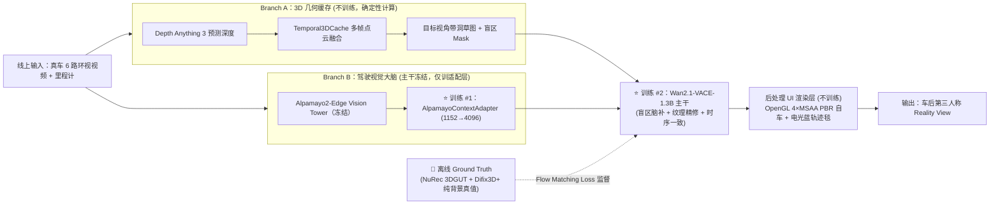

# Research & Engineering Notes: Reality View 全链路、GT 方案与 2024–2026 学术调研

本文档系统记录 `open-tesla-reality-view` 在架构设计、离线 Ground Truth（GT）数据工厂评估、2024–2026 学术界前沿流派调研以及关键渲染工程排障中的核心结论，作为后续 Stage 0 改造、v1 训练与 v2 实时化演进的参考依据。

---

## 1. 全链路总览：离线“造题工厂” vs 线上“实时推理模型”

理解本项目的核心前提是区分两个完全独立的阶段：

1. **Stage 0 离线标准答案工厂（`NuRec 26.10 + Difix3D+`）**
   - 现实中的量产车车尾没有无人机，无法直接同步采集“6 路车身摄像头”与“车后 13 米高空俯视画面”的配对数据。
   - 因此借助 NVIDIA 离线重建好的 3D 高斯驾驶沙盘（`PhysicalAI-Autonomous-Vehicles-NuRec`，1,601 个 20 秒真实街景），在同一时间戳下既渲染 6 路车载输入，又渲染车后第三人称高清真值（经 `Difix3D+` 去伪影），批量生产 `(6路输入 -> 第三人称真值)` 训练对。
   - **定位**：离线 ETL 数据工厂，**不会也不可能部署到陌生道路的车端**。

2. **线上推理模型（`Branch A + Branch B + Wan2.1-VACE + Post-VAE UI`）**
   - 上线后彻底脱离 NuRec 沙盘：只要输入任意陌生道路的 6 路环视视频 + 车辆里程计，即可端到端生成车后第三人称 Reality View。

### 真正需要训练的模块
| 模块 | 代码路径 | 是否训练 | 作用 |
| :--- | :--- | :---: | :--- |
| `Temporal3DCacheProjector` + DA3 | `src/open_reality_view/geometry/projector.py` | 否（确定性/冻结） | 构造几何脚手架，将 ~90% 已知像素锚定在准确 3D 坐标，防幻觉 |
| `AlpamayoVisionEncoder` | `src/open_reality_view/models/alpamayo_encoder.py` | 否（冻结） | 复用开源智驾大模型视觉表征（光照、语义、动态物体） |
| **`AlpamayoContextAdapter`** | `src/open_reality_view/models/alpamayo_encoder.py` | **是（Stage 1A/1B）** | 融合 Plücker Ray 视角编码并做 `1152 -> 4096` 协议转换 |
| **`WanVACETransformer3DModel`** | `src/open_reality_view/models/vace_reality_view.py` | **是（Stage 1B）** | 核心视频生成/修复主干，学习补全盲区、去伪影与多帧连贯 |
| `EgoVehicleCompositor` + `trajectory_overlay` | `src/open_reality_view/geometry/ego_car.py` | 否（OpenGL 渲染） | 在生成背景最上层叠加 4× MSAA PBR 车模与深度遮挡轨迹带 |

---

## 2. 对照特斯拉 FSD v15 Reality View

| 维度 | 特斯拉 FSD v15 Reality View | `open-tesla-reality-view` 路线 | 对齐度与取舍 |
| :--- | :--- | :--- | :--- |
| **核心范式** | 共享 FSD 感知视觉主干（UVE），将“智驾眼中的 3D 世界”直接解码为写实第三人称画面 | 冻结开源智驾视觉主干 `Alpamayo2-Edge` + 神经视频生成解码器 | **核心思想完全对齐** |
| **3D 几何防幻觉** | 依赖海量数据在 UVE 内部学出的强隐式 4D 空间表征 | 外挂 **Branch A（DA3 + 多帧 3D Cache）** 显式投影脚手架 + 15% Dropout | **中小算力务实折中**：500 A100h 级即可稳收敛且零车体漂移 |
| **训练 GT 来源** | 百万车队同路段多车次数据 + 内部大规模 3DGS / Neural World Simulator 重建 | NVIDIA `PhysicalAI-AV-NuRec`（1,601 场景 3DGUT）+ `Difix3D+` | **方法论同源**，开源微缩版 |
| **自车与规划蓝毯** | 车端高精度 3D 自车模型 + 实时环境光反射 + FSD Planner 电光蓝路径毯 | 4× MSAA 213k 面 PBR `.glb` 车模 + NuRec 天空盒 IBL + 深度遮挡蓝毯（后置叠加） | **100% 对齐** |
| **推理与实时性** | AI4/HW4 车端 30+ FPS 流式因果解码（8-frame chunk Mean-Flow） | **v1** 先跑通多步高质量生成；**v2** 做 `Causal-Forcing` 1–2 步蒸馏 + `LongLive` KV-Cache + `Stream-VAE` + FP8 | **先质量、后实时化** |

---

## 3. Ground Truth 生成方式评估与待修工程清单

### 3.1 行业 4 种第三人称 GT 路线对比（2026）
| 路线 | 代表方式 | 优势 | 局限性 |
| :--- | :--- | :--- | :--- |
| **1. 纯游戏引擎仿真** | CARLA / UE5 | 零伪影、几何与深度 100% 精确、视角无限自由 | Sim-to-Real 域差大，真实视频泛化易出现“塑料游戏感” |
| **2. 车队多车重跑 / 实拍** | Tesla / Waymo 内部车队 | 真实光学、零重建伪影 | 开源界无法获取 |
| **3. 预重建 3DGS + 单步扩散精修**（**当前采用**） | `NuRec 26.10` + `Difix3D+` | **开源性价比最高**：真实驾驶光学 + 省去数千卡时单场景建图 | ① 极远处天空/电线偶发 3DGS 团状残影；② 逐帧 `Difix3D+` 有轻微帧间高频抖动；③ 源 6 路输入为二次渲染而非原生 RAW |
| **4. 3DGS + 视频扩散迭代反哺** | `ReconDreamer++` / `DriveDreamer4D` / `StreetCrafter` | 大偏角与帧间一致性达到离线天花板 | 算力贵 **10–30×**（单场景反复跑视频扩散 + 重训 3DGS），难铺千级场景 |

**结论**：主干采用 `NuRec 26.10 + Difix3D+` 仍是开源第一梯队选择，无需推倒重来。

### 3.2 开训前必须修复的 Stage 0 工程缺陷（代码审计结论）
对 `scripts/batch_export_nurec.py` 与 `scripts/precache_features.py` 审计发现以下 **4 项高优先级改进**，须在大规模导出前落地：

1. **GT 必须导出纯背景（严禁先贴自车再过 `Difix3D+`）**
   - 现状：`batch_export_nurec.py` 调用 `render_frame_bundle(..., composite_ego=True)` 后再调用 `refiner.refine()`，会把自车送进 VAE 糊化，且迫使生成模型浪费容量去学画自车。
   - 改造：改为渲染纯背景 → 原生分辨率 `Difix3D+` 精修 → 直接保存为 `chase_gt`；自车与蓝毯仅在推理/可视化后处理叠加。
2. **根治深度图的 Train-Test Skew（训练/推理分布漂移）**
   - 现状：`batch_export_nurec.py` 导出的是 NuRec 完美 3DGS 深度；但线上推理到陌生马路时，只能拿到 `Depth Anything 3` 的带噪估计深度。
   - 改造：在 `precache_features.py` 中优先使用 `DA3-BASE` 估计深度（或按比例混合 DA3 深度 + 随机尺度/边缘抖动）生成 Branch A 投影草图，保证训练分布与真实线上一致。
3. **缓解逐帧 `Difix3D+` 的时序闪烁（Temporal Flicker）**
   - 改造：筛选高 PSNR 场景（`>= 30 dB`）；探索为 `Difix3D+` 提供多参考视角（当前帧前视 + 上一帧已精修帧）或在导出阶段做跨帧一致性校验，过滤残缺严重片段。
4. **同步黄金构图与原生分辨率参考图**
   - 现状：`batch_export_nurec.py` 仍停留在旧低头视角（`offset=(-7.5,0,4.2), pitch=-18°`）与硬编码 `576×1024` 参考图。
   - 改造：同步至已验证的 Tesla 追尾构图（`radius=13.8m, elevation=11.5°, fov_x=74°, look_at=(ego_x+4.5, 0, 1.25)`）并加入随机视角扰动（`azimuth ∈ [-30°, +30°]`、`elevation ∈ [10°, 22°]`），且参考图分辨率与目标分辨率精确对齐，消除二次缩放模糊。

---

## 4. 2024–2026 学术界四大技术流派调研

| 流派 | 代表工作（2024–2026） | 核心机制 | 优势 | 瓶颈 |
| :--- | :--- | :--- | :--- | :--- |
| **流派一：前馈 3D/4D 高斯预测** *(Feed-Forward 3DGS)* | **Instant NuRec** (NVIDIA, 2026) **STORM** (NVIDIA, 2025) **DrivingForward** (AAAI 2025) **Omni-Scene** (CVPR 2025) | 用 ViT/DA3 风格主干单次前向（200ms–1.5s）直接从多视角视频预测分层动态 3DGS | **极快、360° 强一致**；可用普通 6 路视频**自监督训练**，不依赖第三人称 GT | 回归式预测在大偏角（车后高空）盲区易发糊、拉丝、出浮空噪点，视觉质感不及扩散模型 |
| **流派二：3D 缓存 + 可控视频扩散** *(3D-Guided Video Diffusion)* **← 我们当前 v1 路线** | **GEN3C** (NVIDIA, CVPR 2025) **TrajectoryCrafter** (腾讯 ARC, ICCV 2025 Oral) **StreetCrafter** (ZJU3DV, 2025) **ReCamMaster** (ZJU+快手, 2025) | 解耦“确定性 3D 投影草图”与“视频扩散语义生成”，用 3D Cache 锁定结构、扩散模型补全盲区与材质 | **画质天花板最高**、盲区脑补逼真；基于开源视频 DiT 微调，**中小算力（500 A100h）即可落地** | 依赖高质量第三人称配对 GT；多步采样推理慢，需 v2 步数蒸馏 |
| **流派三：离线 3DGS + 视频扩散迭代反哺** *(Iterative Generative Reconstruction)* | **ReconDreamer / ReconDreamer++** (2025) **DriveDreamer4D** (2025) **Difix3D+** (CVPR 2025) **FreeSim** (2025) | 3DGS 渲染大偏角退化图 → 视频/图像扩散修复 → 伪真值倒灌回 3DGS 重优化 | 离线重建画质与帧间稳定性极佳，适合闭环仿真资产生产 | 单场景重优化算力开销大 10–30×，难低成本规模化 |
| **流派四：前馈 4DGS + 单步扩散精修** *(Hybrid Real-Time Target)* | `STORM / Instant NuRec` + `Difix3D+ / 1-step VACE` | 前馈 4DGS（~100–200ms）快速建出完整 3D 高斯场景 → 2ms 任意视角光栅化 → 1 步轻量扩散精修（~30ms） | **兼顾流派一的实时/强 3D 一致性与流派二的照片级画质**；精修器学习难度大幅降低 | 需要强前馈 4DGS 预训练权重作为前端 |

### 演进式架构策略（v1 → v2）
我们的 Branch A 接口只约定输出 `(coarse_rgb, hole_mask, target_depth)`：
- **v1（当前务实落地）**：走 **流派二**（`DA3 + Temporal3DCache` + `Alpamayo2-Edge` + `Wan2.1-VACE`），低算力快速跑出高清效果。
- **v2（平滑切换至流派四）**：待开源前馈 3DGS（如 `DrivingForward` / `Omni-Scene` 或后续开源的 `STORM` / `Instant NuRec`）成熟接入后，可直接**热插拔替换 Branch A 的点云缓存**，并结合 `Causal-Forcing` 1–2 步蒸馏实现车端级实时流式渲染。

---

## 5. 关键渲染与工程排障记录（已解决）

1. **NuRec 时序傅里叶 Albedo 发灰洗白**（commit `a3adc4b`）
   - 根因：NuRec 26.10 `features_albedo` 形状为 `[N, K, 3]`，索引 `0` 为常值 DC 基色，`1..K-1` 为零均值时序谐波（对静态/部分动态体为 0）；此前取 `mean(dim=1)` 导致颜色被衰减 5×–20×。
   - 修复：提取 `albedo[:, 0, :]`（`nurec_renderer.py::_extract_base_albedo`）。
2. **画质糊化与自车被 VAE 模糊**（commit `282307f`）
   - 根因：早期流程先贴自车、再 `480p -> 576p -> 480p` 双线性缩放过 `Difix3D+` 且参考图仅 `224×384`。
   - 修复：`Difix3DRefiner.refine()` 默认 `process_hw=None` 原生分辨率（`720×1280`）精修纯背景，喂同分辨率前视参考图；**在 VAE 解码之后**再叠加 4× MSAA OpenGL PBR `.glb` 自车与电光蓝轨迹毯。
3. **3DGS 路面矩形“画面撕裂”与地下薄片穿帮**（commit `33cda92`）
   - 根因（双重叠加）：
     1. `triton_3dgs.py` 原设 `max_radius_px = 96` 硬截断，将屏幕半径 `150–480+ px` 的大扁平高斯强行切在 `16×16` tile 矩形边界上；
     2. NuRec 26.10 由 NVIDIA `3dgut-gsplat`（径向距离 + 3D 射线交点）训练，路面下 `1.4m` 藏有 `4.5m × 2.0m × 5mm` 扁平背景高斯；原光栅化器按高斯中心 `z` 排序，在 `z_路面 == z_中心` 处令地下薄片突然穿透路面。
   - 修复：移除 `96px` 硬截断改为透明度精确紧致椭圆分桶 `extend = sqrt(2 * ln(255 * opacity))`；采用**混合径向距离 + 大高斯逐 Tile 3D 射线交点深度 `t_hit` 排序（3DGUT / StopThePop 思想）**。
   - 收益：彻底消除所有矩形/水平撕裂，同时连带提升环视深度纯净度，将多帧 3D Cache 盲区率由 `9.2%` 进一步降至 `5.7%–6.6%`。
